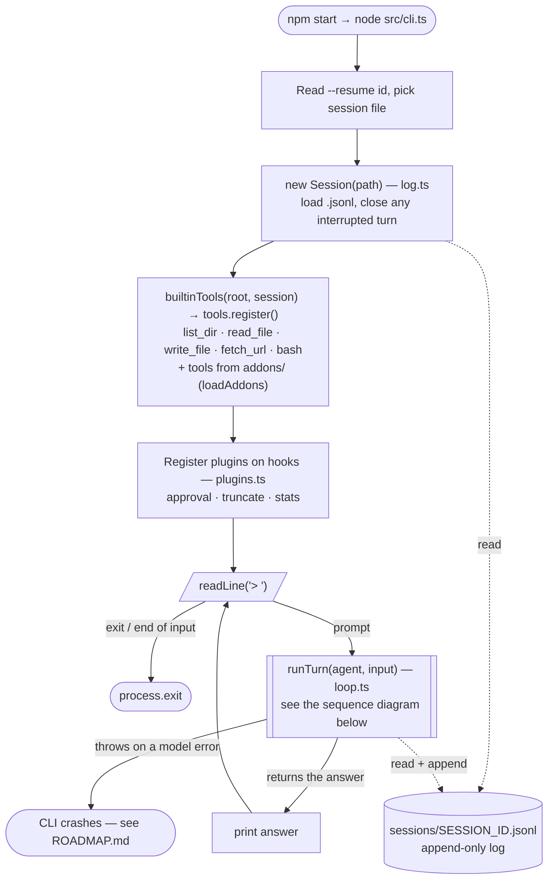
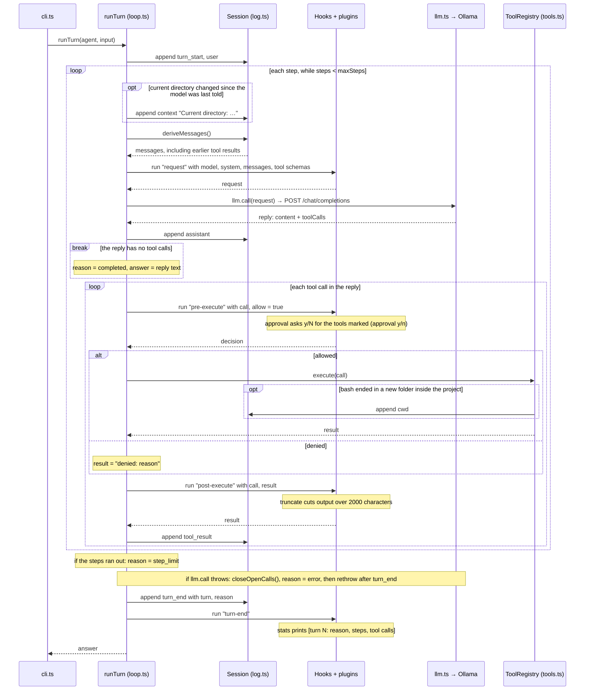

# tiny-harness

A minimal coding-agent harness: a model chooses tools, the harness runs them, and every step is recorded in an append-only session log.

## Install on Ubuntu

Download the `.deb` for your CPU (`amd64` for most PCs, `arm64` for ARM machines) from the [latest release](https://github.com/karthikeyanrathore/tiny-harness/releases/latest), then:

```sh
sudo apt install ./tiny-harness_*_amd64.deb   # Ubuntu 22.04 or later; brings its own Node.js, no Python
tiny-harness                                  # start it in any folder
```

Sessions are kept in `~/.local/share/tiny-harness/sessions`. Remove it with `sudo apt remove tiny-harness`.

### Optional: Google Calendar add-on

Only if you want the model to manage your calendar. It brings Python and the Google libraries, so it is a separate package (`_all` works on every CPU):

```sh
sudo apt install ./tiny-harness-calendar_*_all.deb
tiny-harness                                  # then type /install-gcal: a guided 5-minute setup, once
```

`/install-gcal` (or `tiny-harness calendar-setup` from the shell) installs the Google libraries for your user, walks you through creating your own free Google OAuth client, and signs you in. Its files are kept in `~/.local/share/tiny-harness/calendar` and `~/.config/tiny-harness/calendar`. Until setup is done the calendar tools stay hidden from the model. Remove it with `sudo apt remove tiny-harness-calendar`.

## Requirements (from source)

- Node.js 22.18+ (runs the `.ts` files directly, no build step)
- [Ollama](https://ollama.com) with a model that supports tool calls, or any OpenAI-compatible API

## Setup

```sh
npm install      # only TypeScript and type definitions, for `npm run typecheck`
ollama signin    # the default model runs on Ollama's cloud (free plan)
```

## Run

```sh
npm start                              # gemma4:31b-cloud through local Ollama
npm start -- --resume <session-id>     # continue a saved session
```

Type a prompt at `>`, and `exit` to quit. Tools marked *(approval y/n)* below ask first (`y` to allow).

Try: `what files are in this folder?`, `read package.json`, `run ls -la`, `summarize https://example.com`.

Sessions are saved as `sessions/<session-id>.jsonl`.

## Tools

- [x] **`list_dir`** — list a folder's entries; folders end with `/`.
- [x] **`read_file`** — read a UTF-8 text file.
- [x] **`write_file`** *(approval y/n)* — create or overwrite a UTF-8 text file.
- [x] **`fetch_url`** *(approval y/n)* — fetch an http(s) page and return its text without HTML tags.
- [x] **`bash`** *(approval y/n)* — run a shell command; a `cd` carries over to later calls and the other tools, but only inside the project.

### Add-ons

Optional tools live in `addons/<name>/`. The harness loads each `addons/<name>/index.ts` at startup; an add-on that is not set up offers no tools. Add-ons can bring commands, typed at the prompt with a leading `/` (`/help` lists them); after a command the add-ons are loaded again, so a finished setup works at once. The core package ships without `addons/`.

**Calendar** (`addons/calendar/`), set up with **`/install-gcal`**:

- [x] **`google_calendar_add_event`** *(approval y/n)* — add an event to your primary Google Calendar.
- [x] **`google_calendar_list_events`** — list events between two times, with their ids.
- [x] **`google_calendar_delete_event`** *(approval y/n)* — delete an event by id.

From source, `/install-gcal` works the same way but uses the project's `.venv`, with `credentials.json` and `token.json` in the project folder. By hand:

```sh
python3 -m venv .venv
.venv/bin/python3 -m pip install --only-binary=cryptography -r addons/calendar/requirements.txt
# put the OAuth "Desktop app" client from Google Cloud Console in credentials.json, then:
addons/calendar/gcal login   # opens the browser once, saves token.json
```

`credentials.json` and `token.json` are git-ignored.

## How it works

### Startup and prompt loop

`src/cli.ts` sets everything up once, then calls `runTurn` for each prompt. Dotted arrows are reads and writes to the session log.



### One turn: `runTurn`

A turn handles one prompt. Each step is one model call plus the tool calls the reply asks for. The model sees earlier tool results because every step rebuilds the messages from the log with `deriveMessages()`.



## Use another model

Point it at any OpenAI-compatible `/chat/completions` endpoint:

```sh
LLM_MODEL=qwen3.5:0.8b npm start                     # a local model; nothing leaves your machine

LLM_BASE_URL=https://api.deepseek.com/v1 \
LLM_MODEL=deepseek-chat \
LLM_API_KEY=sk-... npm start                         # a hosted API
```

| Variable | Default |
|---|---|
| `LLM_BASE_URL` | `http://127.0.0.1:11434/v1` |
| `LLM_MODEL` | `gemma4:31b-cloud` |
| `LLM_API_KEY` | none |

`-cloud` models run on Ollama's servers: your prompts and any file contents the tools read are sent there. Very small local models such as `qwen3.5:0.8b` handle single-tool questions but get lost on multi-step tasks.

## Test

```sh
npm test         # offline; uses scripted model replies and a mock HTTP server
npm run typecheck
```

## Build the Ubuntu packages

```sh
scripts/build-deb.sh amd64    # or arm64; writes dist/tiny-harness_<version>_<arch>.deb
                              # and the add-on dist/tiny-harness-calendar_<version>_all.deb
```

The `release` workflow builds them for amd64 and arm64, installs them on clean Ubuntu 22.04 and 24.04 (`packaging/test-install.sh`: the core alone first, checking no Python comes with it, then the add-on), and on a `v*` tag publishes them as a GitHub release. To release: bump `version` in `package.json`, then `git tag v<version> && git push origin v<version>`.
