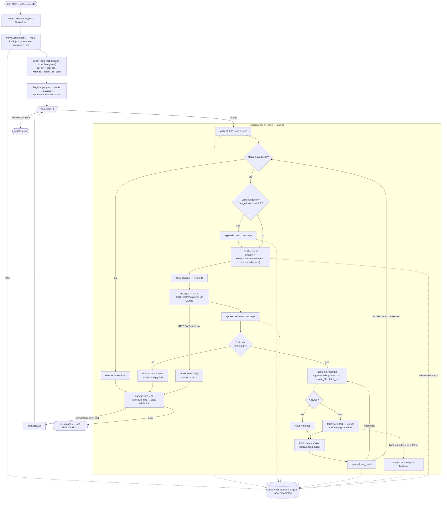

# tiny-harness

A minimal coding-agent harness: a model chooses tools, the harness runs them, and every step is recorded in an append-only session log.

## Requirements

- Node.js 22.18+ (runs the `.ts` files directly, no build step)
- [Ollama](https://ollama.com) with a model that supports tool calls, or any OpenAI-compatible API

## Setup

```sh
npm install      # only TypeScript and type definitions, for `npm run typecheck`
ollama signin    # the default model runs on Ollama's cloud (free plan)
```

## Run

```sh
npm start                              # gemma4:31b-cloud through local Ollama
npm start -- --resume <session-id>     # continue a saved session
```

Type a prompt at `>`, and `exit` to quit. Calls to `bash`, `write_file` and `fetch_url` ask for approval first (`y` to allow).

Try: `what files are in this folder?`, `read package.json`, `run ls -la`, `summarize https://example.com`.

Sessions are saved as `sessions/<session-id>.jsonl`.

## How it works

Solid arrows show the order the code runs in; dotted arrows are reads and writes to the session log. After tool results are logged, the next step rebuilds the request from the log, which is how the model sees them.



## Use another model

Point it at any OpenAI-compatible `/chat/completions` endpoint:

```sh
LLM_MODEL=qwen3.5:0.8b npm start                     # a local model; nothing leaves your machine

LLM_BASE_URL=https://api.deepseek.com/v1 \
LLM_MODEL=deepseek-chat \
LLM_API_KEY=sk-... npm start                         # a hosted API
```

| Variable | Default |
|---|---|
| `LLM_BASE_URL` | `http://127.0.0.1:11434/v1` |
| `LLM_MODEL` | `gemma4:31b-cloud` |
| `LLM_API_KEY` | none |

`-cloud` models run on Ollama's servers: your prompts and any file contents the tools read are sent there. Very small local models such as `qwen3.5:0.8b` handle single-tool questions but get lost on multi-step tasks.

## Test

```sh
npm test         # offline; uses scripted model replies and a mock HTTP server
npm run typecheck
```
