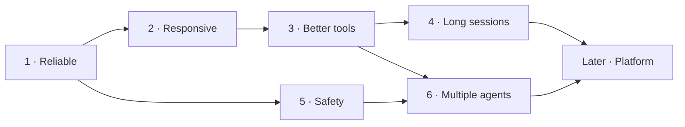

# Roadmap

How tiny-harness grows toward [DeepSeek Harness](https://github.com/deepseek-ai/deepseek-harness) (dsh). Each phase has a goal and a check for when it is finished, and phases build on the ones before them. Notes in *(dsh: …)* point to the matching part of dsh.

## Phase 1 — Reliable

**Goal:** the harness never crashes, and the log holds everything the model sees.
**Done when:** a wrong model name or a dropped connection prints an error and the REPL keeps running, and a session can be replayed from its log alone.

- [x] **`cd` is remembered between bash calls.** The current folder is stored in the log, shared by all tools, and sent to the model when it changes.
- [ ] **Don't crash on a model error.** Catch errors from `runTurn` in `cli.ts`, print them, and keep the session open.
- [ ] **Retries.** Retry failed model requests a few times with backoff for network errors and 5xx. *(dsh: `agent/request-error` hook, `llm/llm-retry`)*
- [ ] **Log the system prompt.** Right now it is the only thing the model sees that isn't in the log. *(dsh rule: "model-visible means logged")*
- [ ] **Keep file tools inside the project.** `read_file` and `write_file` accept `../` and absolute paths. Apply the same check `cd` uses.
- [ ] **Raise the 2,000-character output limit.** Long files and web pages lose most of their content. Raise it, or save big outputs to a file and give the model a pointer. *(dsh: `spill`)*
- [ ] **Show the folder in the approval prompt**, e.g. `Allow bash in src/: rm -rf build?`
- [ ] **Print the answer before the stats line.** The `turn-end` hook currently fires first.

## Phase 2 — Responsive

**Goal:** the agent feels fast and can be stopped.
**Done when:** replies appear as they are generated, and Ctrl-C stops the current call and returns to the prompt.

- [ ] **Streaming.** *(dsh: `agent/assistant-stream`)*
- [ ] **Cancellation.** Pass an `AbortSignal` through the loop, the model and the tools. *(dsh: every step has an abort signal)*
- [ ] **Parallel tool calls.** Run read-only tools (`read_file`, `list_dir`, `fetch_url`) at the same time; keep the others one at a time. *(dsh: `isConcurrencySafe`)*
- [ ] **`pre-step` hook.** Rewrite or reject user input before the model sees it. *(dsh: `agent/pre-step`)*

## Phase 3 — Better tools

**Goal:** the agent can do real coding work without rewriting whole files.
**Done when:** it can find a bug, plan the fix, edit only the right lines, and run the tests.

- [ ] **`edit_file`.** Find and replace instead of rewriting the whole file. *(dsh: `fs`)*
- [ ] **Task list.** A `todo_write` tool the model uses to plan and track its own steps. *(dsh: `todo`, `plan`)*
- [ ] **Web search.** `fetch_url` only opens links you already have. *(dsh: `web`)*
- [ ] **Long-running commands.** Background processes and terminals that stay open across calls. *(dsh: `terminal`, `jobs`)*

## Phase 4 — Long sessions

**Goal:** sessions can run for hours and be found again later.
**Done when:** a session that goes past the model's context limit keeps working, and old sessions can be listed, searched and forked.

- [ ] **Log format version.** Do this first so that the later items can change the log format without breaking old sessions. *(dsh: session format migrations)*
- [ ] **Token counting.** Track tokens per request. Compaction needs this. *(dsh: `llm/token-meter`)*
- [ ] **Compaction.** Summarize old turns when the history gets close to the limit. *(dsh: `compaction`)*
- [ ] **Session list and search.** *(dsh: `session-query`)*
- [ ] **Fork a session** from any earlier turn.

## Phase 5 — Safety

**Goal:** you can leave the agent running without approving every command.
**Done when:** safe commands run without asking, dangerous ones are blocked by rule, and bash can't touch files outside the project.

- [ ] **Policy rules.** For example: always allow `ls`, never allow `rm -rf`. *(dsh: `guard`, `ToolGuard`)*
- [ ] **Sandbox.** Run bash in a restricted environment such as macOS `sandbox-exec` or a container. *(dsh: `sandbox`)*
- [ ] **API key storage.** Keys currently come only from environment variables. *(dsh: `credentials`)*

## Phase 6 — Multiple agents

**Goal:** the model can hand sub-tasks to helpers that have fewer permissions.
**Needs:** policy rules from phase 5 to limit what a child agent can do.
**Done when:** the model starts a read-only "researcher" child agent, and its answer comes back as a tool result.

- [ ] **Subagent tool.** *(dsh: `subagent`, `tools.restrict()`)*
- [ ] **Agent presets.** Named sets of tools and prompts, such as "reviewer" or "researcher". *(dsh: `preset`)*

## Later — Platform

These have no set order. Pick them up when you need them.

- [ ] **Plugins from config** instead of editing `cli.ts`. *(dsh: Cordis plugins, profiles and bundles)*
- [ ] **MCP servers.** *(dsh: `mcp`)*
- [ ] **Skills.** Instruction files the model can load for specific tasks. *(dsh: `skill`)*
- [ ] **Code mode.** One `run_code` tool that lets the model script the other tools. *(dsh: PTC mode)*
- [ ] **Language server.** Go to definition and type errors. *(dsh: `lsp`)*
- [ ] **More model providers**, such as Anthropic-style APIs. *(dsh: `llm/llm-pi-ai`)*
- [ ] **Images and attachments.** *(dsh: `attachment`)*
- [ ] **Other front ends.** A web UI or an SDK. *(dsh: `web`, `sdk`, `acp`)*
