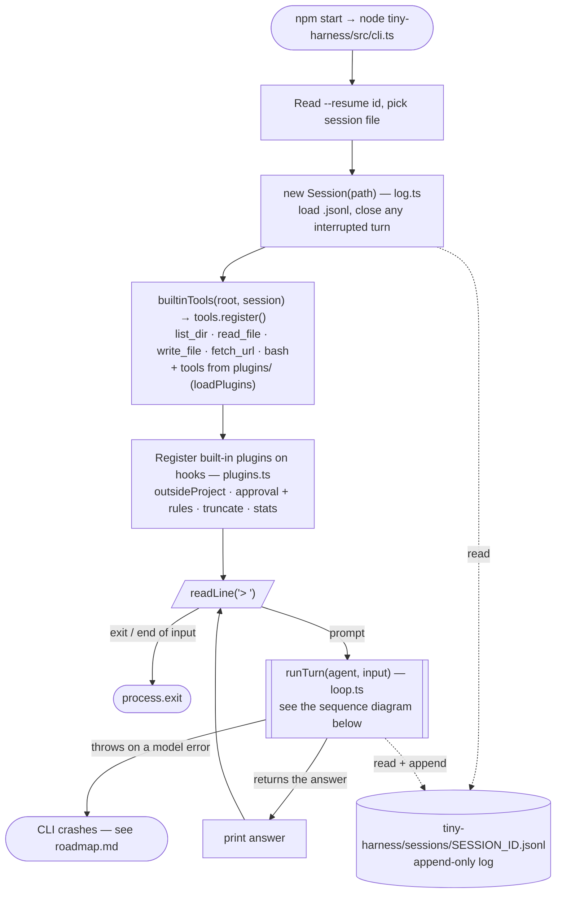
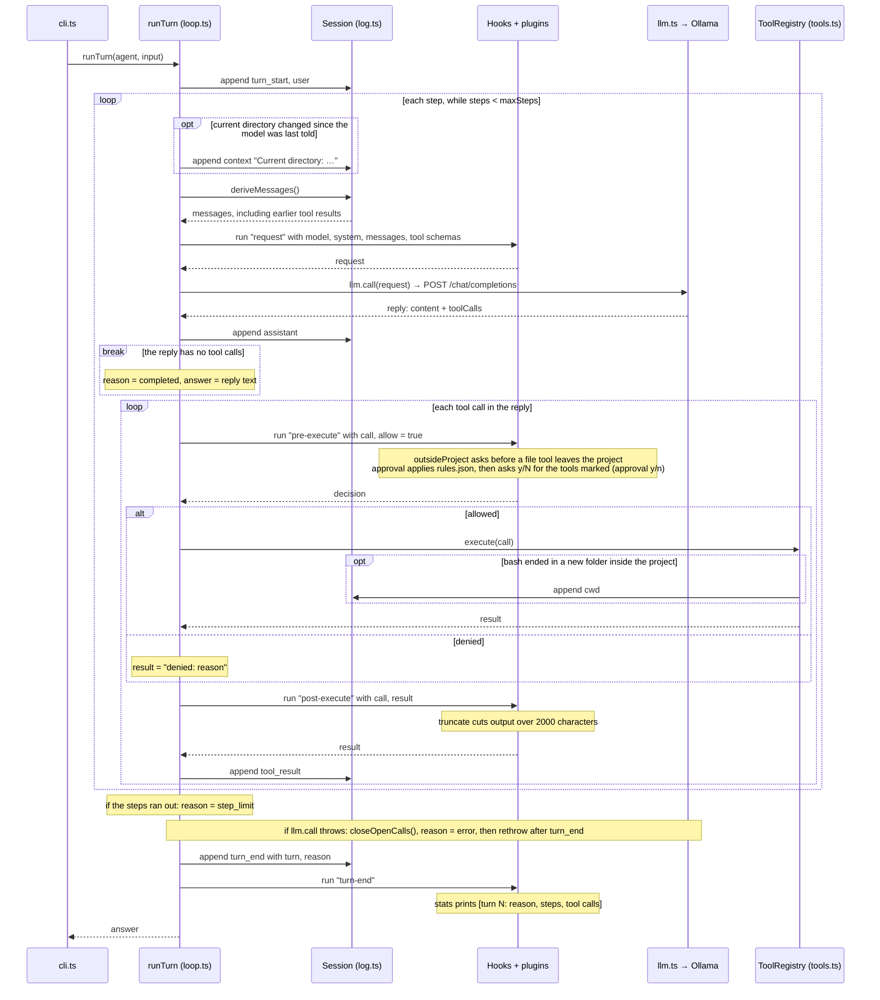

# How it works

## Startup and prompt loop

`tiny-harness/src/cli.ts` sets everything up once, then calls `runTurn` for each prompt. Dotted arrows are reads and writes to the session log.

## One turn: `runTurn`

A turn handles one prompt. Each step is one model call plus the tool calls the reply asks for. The model sees earlier tool results because every step rebuilds the messages from the log with `deriveMessages()`.

